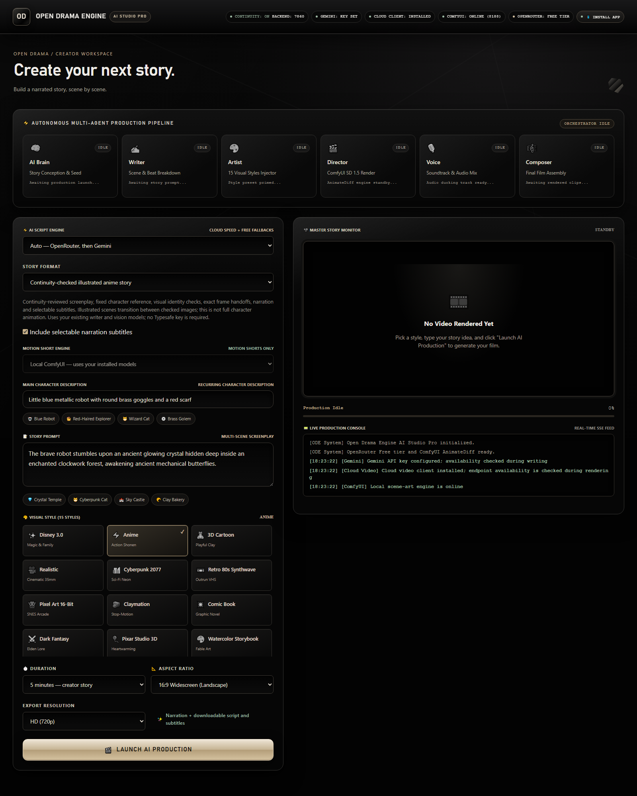

# Open Drama Engine — continuity-checked story studio

The dashboard and headless entry point share one durable pipeline for narrated,
illustrated stories from 12 seconds to 25 minutes. This is not full character
animation or lip sync. Motion and independent shot/timeline generation are blocked
because those routes cannot enforce project character and frame continuity.

## Required setup

Use the existing Python environment, installed dependencies in requirements.txt,
FFmpeg/FFprobe on PATH, Windows SAPI narration, and local ComfyUI with a working
SD 1.5 checkpoint. Keep credentials in .env beside app.py:

- OPENROUTER_API_KEY or GEMINI_API_KEY: screenplay generation.
- Visual checks use Gemini, with an existing OpenRouter vision model as fallback.
- CONTINUITY_VISION_MODEL=gemini-flash-latest (optional observer override).
- COMFYUI_BASE_URL=http://127.0.0.1:8188
- COMFYUI_DIR=D:\AI DEVELOPMENTS\ComfyUI

The Typesafe skill supplies the application's structured judgment design; it
requires no separate key. Existing writer models generate prose and independently
review narrow continuity criteria with typed boolean decisions and factual evidence.
Uncertainty or missing evidence rejects the candidate. This is skill-guided review,
not the hosted Jev model, and it does not invent calibrated probabilities.
Gemini observes actual reference/candidate images using your existing vision key;
OpenRouter provides a fallback when Gemini is unavailable, only after explicit
authorization and ALLOW_OPENROUTER_VISION=1. It is disabled by default.
Text and images use the existing configured generation services and their quotas.
No request is sent to api.typesafe.ai. Any TYPESAFE_API_KEY in .env is unused.

Run python -B app.py, open http://127.0.0.1:7860, or use npm start for Electron.
The dashboard shows continuity review status and rejects unchecked production.

## Continuity rules

A project freezes its character bible, screenplay, writer settings and first
verified visual reference. Changing them requires a new project. Each scene's
start_state must exactly equal the preceding scene's end_state; the structured reviewer checks that
narration, appearance, possessions and causal action support that handoff.

Later art is image-conditioned from the previous final frame, then compared with
the immutable visual reference. Contradictions, uncertainty, provider failures
and failed structured judgments stop export; rejected art gets up to three attempts.
Structured decisions require explicit evidence and no uncertainty. Model-based
visual judgments reduce drift but cannot guarantee perfect character identity;
pixel-level joins are verified deterministically.

Illustrated scenes use a one-second dissolve from the previous final frame to
checked scene art. Lossless RGB H.264 intermediates preserve exact decoded pixels at joins. The
creator export uses standard YUV420 H.264 with fixed-quantizer intra frames,
then checks every decoded join again in that delivered file. This uses more
storage than long-GOP video. The lossless continuity_master.mp4 is retained.
Social-media transcoding can change decoded pixels and would need its own check.

Subtitles are selectable MP4 tracks and exported SRT, rather than burned into
scene joins. Burned text changes the boundary pixels. Narration is offline SAPI.

## Recovery and evidence

Each project is in generated_assets/jobs/<job_id>/, with outline/draft/script,
canon.json, character_reference.png, identity reviews, art receipts, narration,
clips, start/end PNGs, handoff hashes, final join frames and master_story.mp4.
Existing projects are preserved. Resume last interrupted story reuses artifacts
only when their hashes, canon and joins verify. Older unverified independent
scenes cannot be silently resumed under the new rules; create a new project.

Headless: python -B headless_orchestrator.py --prompt "Your premise" --duration 300
or npm run engine:run -- --prompt="Your premise" --duration=300.

Checks: python -B -m pytest test_story_repairs.py test_continuity.py -q
Controlled service doubles verify API failures/approval rules; real FFmpeg tests
verify narration timing, lossless decoded joins and assembled joins. Live writer review,
vision/provider and long-form output require valid credentials and quota and
must be tested separately. No placeholder is reported as a finished film.

Optional OPENROUTER_VISION_MODEL overrides the current free image-input model.
